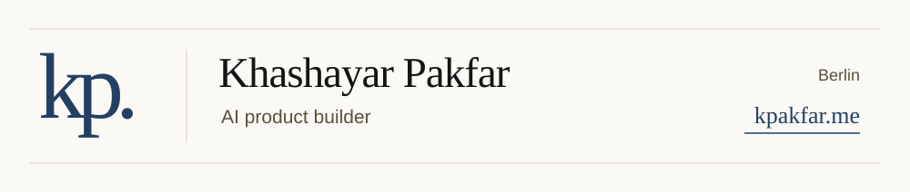

<a href="https://kpakfar.me">
  <picture>
    <source media="(prefers-color-scheme: dark)" srcset="assets/nameplate-dark.svg">
    
  </picture>
</a>

## I build AI products

I'm Khashayar, a product manager and builder in Berlin. I've worked in software since 2009, including enterprise systems and travel marketplaces. Today I use AI coding agents to turn product ideas into working software.

I design the workflow and check the results. When a tool can act on someone's behalf, I build in human approval.

**[kpakfar.me](https://kpakfar.me)** is my portfolio. My AI twin, kp, answers questions about my work from my public notes, with citations.

## Selected work

### [LeadRadar](https://github.com/Kpakfar/leadradar)

A sales brief becomes researched, scored leads and outreach drafts. Each draft points back to its sources; a person reviews it before use. Built with LangGraph, with separate knowledge for each brief.

### [Mentat](https://github.com/Kpakfar/mentat)

A strategy advisor for HR-tech product decisions. It combines document search with structured tools and cited answers. Includes a fictional company dataset and [published evaluation traces](https://github.com/Kpakfar/mentat/blob/main/eval/runs.md).

### [German tax skill](https://github.com/Kpakfar/german-tax-skill)

An agent helps prepare a German tax return. Scripts check amounts against documents and apply supported limits. The person reviews and files. A reusable template, not tax advice.

## The tools behind the work

| Project | What it does |
| :--- | :--- |
| [ForgeWorks](https://github.com/Kpakfar/ForgeWorks) | Gives AI coding agents a workflow with planning, tests, reviews and quality gates. |
| [testbite](https://github.com/Kpakfar/testbite) | Changes the lines in a git diff to find bugs that passing tests miss. |
| [TandemView](https://github.com/Kpakfar/tandemview) | Runs practice interviews from a CV and job description, with [documented prompt evaluation](https://github.com/Kpakfar/tandemview/blob/main/docs/EVALUATION.md). |

---

Based in Berlin. I work in English and German. More about me at [kpakfar.me](https://kpakfar.me).
