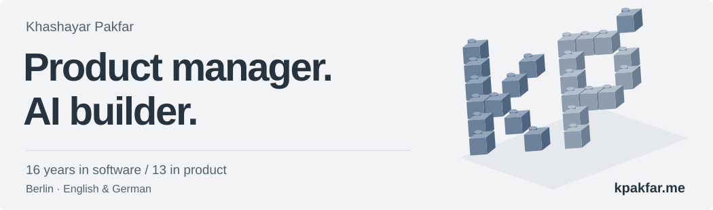

<a href="https://kpakfar.me">
  <picture>
    <source media="(max-width: 600px) and (prefers-color-scheme: dark)" srcset="assets/builder-mobile-dark.svg">
    <source media="(max-width: 600px)" srcset="assets/builder-mobile-light.svg">
    <source media="(prefers-color-scheme: dark)" srcset="assets/builder-dark.svg">
    
  </picture>
</a>

I've led a 30-person marketplace unit and taken AI products from concept to launch. Today I use AI coding agents to build products I design. People approve consequential actions.

**[Explore my work and ask my AI twin at kpakfar.me](https://kpakfar.me)**

<table>
<tr>
<td width="33%" valign="top"><h3>4 months</h3>AI concept to launch Deutschtec.ai</td>
<td width="34%" valign="top"><h3>60% less</h3>Manual HR casework BEM Center</td>
<td width="33%" valign="top"><h3>5,400 homes</h3>Onboarded in 9 months Jabama</td>
</tr>
</table>

## Open something I built

<table>
<tr>
<td width="22%" valign="top"><a href="https://github.com/Kpakfar/leadradar"><strong>LeadRadar</strong></a> Sales research</td>
<td>A sales brief becomes researched leads and outreach drafts. A person reviews each sourced draft. <a href="https://github.com/Kpakfar/leadradar#using-it">See the workflow</a></td>
</tr>
<tr>
<td valign="top"><a href="https://github.com/Kpakfar/mentat"><strong>Mentat</strong></a> Product strategy</td>
<td>An HR-tech advisor that supports product decisions with cited evidence. Test it against a fictional company. <a href="https://github.com/Kpakfar/mentat/blob/main/eval/runs.md">Read the evaluations</a></td>
</tr>
<tr>
<td valign="top"><a href="https://github.com/Kpakfar/ForgeWorks"><strong>ForgeWorks</strong></a> Agentic development</td>
<td>The workflow I use to build: agents plan, write tests and review changes. Quality gates must pass before a merge. <a href="https://github.com/Kpakfar/ForgeWorks#how-it-works">Look inside</a></td>
</tr>
</table>

Also built: [testbite](https://github.com/Kpakfar/testbite), which finds gaps in passing tests; [TandemView](https://github.com/Kpakfar/tandemview), for interview practice; and a [German tax preparation skill](https://github.com/Kpakfar/german-tax-skill).

---

Open to AI product roles in Germany. [My experience](https://kpakfar.me/journey/) · [Talk to kp](https://kpakfar.me)
